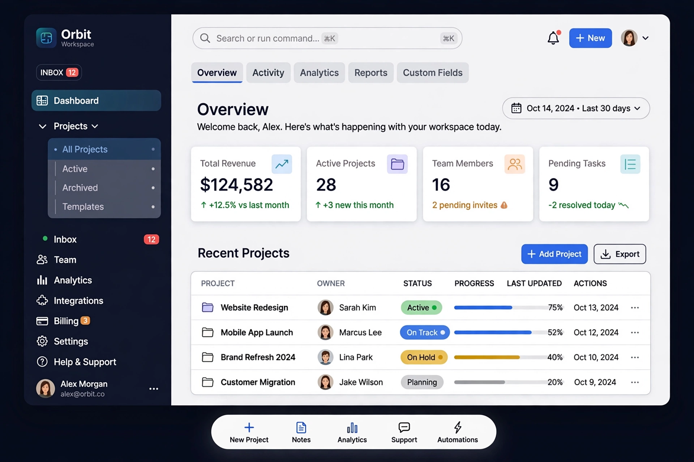

# SaaS后台

## Linear 风 SaaS 数据后台 (`saas-dashboard-linear`)

- 风格：极简 / 深色 / 专业
- 场景：项目管理/协作类 SaaS 首页仪表盘
- 适用工具：v0、Lovable、Cursor

**EN prompt（复制用）**

```
Design a clean SaaS analytics dashboard in the style of Linear: dark sidebar navigation, light content area, compact data tables, KPI cards with sparklines, a line chart and a bar chart, status badges, subtle borders instead of heavy shadows, 8px spacing system, Inter font, primary color indigo #5E6AD2, rounded-lg corners, professional and information-dense but uncluttered.
```

**中文说明**：Linear 风极简 SaaS 仪表盘：深色侧边栏、紧凑表格、KPI 卡片+迷你趋势图、状态徽章、细边框少阴影、靛蓝主色、信息密集但不乱。

## 浅色企业管理系统 (`saas-admin-light`)

- 风格：浅色 / 企业级 / 表格密集
- 场景：订单/用户/权限等后台管理 CRUD
- 适用工具：v0、Cursor、Qoder

**EN prompt（复制用）**

```
Build an enterprise admin panel UI: top header with search and user avatar, left collapsible menu, breadcrumb, filter bar with date range and dropdowns, a paginated data table with row selection, status pills and action buttons, a slide-over detail drawer and a modal form. White and light gray palette, blue primary #1677FF, clear hierarchy, designed for daily heavy use, no decorative gradients.
```

**中文说明**：企业级浅色后台：顶栏+可折叠菜单、筛选条、分页表格、状态标签、详情抽屉和弹窗表单，蓝色主色，耐看实用不要花哨渐变。

## 看板协作工具 (`saas-kanban`)

- 风格：卡片 / 协作 / 彩色标签
- 场景：任务看板/项目进度管理
- 适用工具：v0、Lovable

**EN prompt（复制用）**

```
Create a Kanban project board UI like Trello/Linear: horizontal columns (Backlog, In Progress, Review, Done) with drag-ready cards, each card shows title, colored labels, assignee avatars, due date and comment count; top bar with board switcher, filter and members; soft gray background #F4F5F7, white cards with subtle shadow, friendly but professional.
```

**中文说明**：看板协作 UI：横向列+可拖拽卡片，卡片带彩色标签、成员头像、截止日期，浅灰底白卡片。

## 设置页主从布局 (`saas-settings-master-detail`)


生成验证：✅ 2026-11-17 通过 — 生成图为设置页：左侧六项导航 Notifications 高亮，右侧分组卡片行式设置（左标题说明、右开关/下拉），底部 Unsaved changes 吸底条与红色 Danger zone 卡片均出现，通过

- 风格：主从布局 / 表单 / 设置
- 场景：产品设置/账户/团队管理页
- 适用工具：v0、Cursor、Lovable

**EN prompt（复制用）**

```
Design a settings page in a master-detail layout: left vertical nav (Profile, Account, Notifications, Billing, Security, Team) with the active item highlighted; right panel shows the active section as grouped cards, each setting as one row — title and helper text on the left, the control (toggle, select or button) on the right, comfortable 56px row height. Save per section and show a sticky 'Unsaved changes' bar at the bottom only when edits are pending. Put destructive actions in a separate red-bordered 'Danger zone' card at the very bottom. Calm neutral palette, one accent, no endless ungrouped scroll.
```

**中文说明**：设置页主从布局：左侧分组导航、右侧按卡分组的设置行（标题+说明+右侧控件）、有改动才吸底保存条、危险操作单独红框放最底。

## SpicyTater：后台菜单交互 8 类选型 (`spt-admin-menu`)



生成验证：✅ 2026-11-19 通过 — 生成图为 Orbit 后台：滑动高亮块选中 Dashboard、Projects 就地展开子菜单、顶部页签带高亮、⌘K 命令面板搜索条、Inbox 12 徽标+状态点、底部悬浮停靠栏齐全，通过

- 风格：后台菜单、交互选型、章节摘录
- 场景：做后台/侧栏导航菜单，不知道用哪种展开方式时
- 适用工具：v0、Lovable、Cursor

**EN prompt（复制用）**

```
Choose admin menu patterns by structure: sliding highlight block for sidebar nav and top tabs; expand-in-place submenus for hierarchical project/file trees; top drop-down panel when there are few sections but multiple entries (mouse and keyboard); floating bottom dock for frequent entries (magnify on hover, neighbours make room); command palette when entries are many (search + keyboard selection); status dots and count badges for new messages and pending items, animating the number when it changes. Pick the combination by section count, hierarchy depth and usage frequency; entries must stay obvious and reachable.
```

**中文说明**：SpicyTater 第22集（2062赞）：滑动高亮块/就地展开/顶部下落面板/底部悬浮停靠栏/命令面板/状态点徽标等 8 类后台菜单，按栏目数量、层级、频率选组合。
