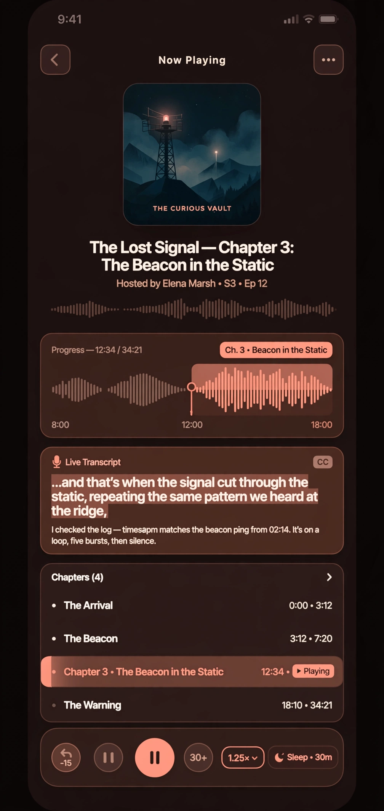

# 内容社交

## 社交内容流 App (`social-feed`)

- 风格：瀑布流 / 图片主导 / 年轻
- 场景：图片社交/种草类 App
- 适用工具：v0、即梦

**EN prompt（复制用）**

```
Design a social discovery app home feed: two-column masonry waterfall of image cards with short titles, author avatar and like count, top category tabs, floating publish button, warm white background, coral accent color, youthful and browsable, cards with varied heights, minimal chrome so content shines.
```

**中文说明**：种草社交 App：双列瀑布流图片卡、分类 tabs、悬浮发布按钮、珊瑚色点缀，内容为主、界面退后。

## 音乐播放器界面 (`music-player`)

- 风格：沉浸 / 深色 / 专辑图主导
- 场景：音乐 App 播放页与首页
- 适用工具：v0、Midjourney、即梦

**EN prompt（复制用）**

```
Create a music app UI: immersive player screen with large album artwork, blurred album-color background gradient, song title and artist, progress bar with lyrics line highlighted, shuffle/previous/play/next/repeat controls; home screen with personalized playlist cards and recently played row. Dark theme, artwork colors drive the palette, elegant and emotional.
```

**中文说明**：音乐 App：播放页大专辑图+同色模糊渐变背景、歌词高亮、进度条；首页个性化歌单卡，深色沉浸、颜色跟着封面走。

## 播客播放器：章节波形+逐字稿 (`mobile-podcast-player`)



生成验证：✅ 2026-11-18 通过 — 生成图为播客播放页：封面+标题主持人、波形章节间隙与当前章节色带、逐字稿大字高亮、章节列表高亮当前章、-15/+30+大播放盘+1.25x倍速+Sleep定时，暖深色珊瑚强调色，通过

- 风格：播客 / 音频播放 / 章节
- 场景：做播客 App，想要章节导航+逐字稿跟读的沉浸式播放页时
- 适用工具：v0、Lovable、Cursor

**EN prompt（复制用）**

```
Design a mobile podcast player screen: a full-screen now-playing view with the show cover art on top, episode title and host below; a waveform scrubber where chapter boundaries appear as visible gaps between bar groups and the current chapter shows as a dim band, so listeners see where they are in the story; a transcript card where the current sentence is large and highlighted and fills in word by word as it plays; a chapter list that highlights and scrolls to the current chapter, tapping a row seeks to its start. Transport row in the thumb zone: skip back 15s / forward 30s, large play/pause disc, speed pill cycling 1x, 1.25x, 1.5x, 2x, and a sleep timer (15/30/45 min or end of chapter). Warm dark background with one coral accent, large rounded surfaces, one-thumb use throughout.
```

**中文说明**：播客播放器：波形进度条上直接显示章节分界与当前章节、逐字稿跟随高亮、章节列表自动跟随可点跳转，含 15/30 秒快进快退、倍速与睡眠定时，暖深色+珊瑚强调色。
