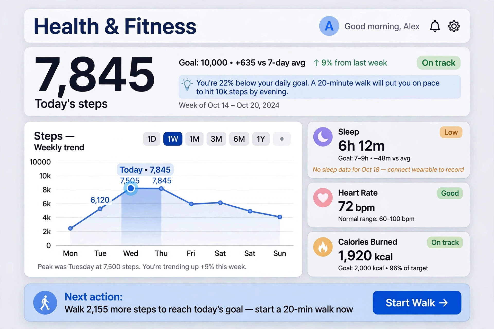

# 数据大屏

## 数据大屏指挥中心 (`datav-screen`)

- 风格：深蓝 / 发光 / 大屏
- 场景：城市/业务数据可视化大屏 16:9
- 适用工具：v0、即梦、Midjourney

**EN prompt（复制用）**

```
Design a 16:9 data visualization command-center screen: deep blue-black background, central map with glowing points and connection arcs, side panels with KPI numbers in large glowing digits, line/bar/gauge charts with cyan and electric blue palette, thin tech-style corner brackets on panels, subtle grid background, futuristic control-room feel, all text legible from a distance.
```

**中文说明**：数据大屏：深蓝黑底、中央发光地图、两侧 KPI 大数字与图表、青蓝发光配色、面板科技切角，远距离可读。

## 数据报告/信息图页 (`datav-report`)

- 风格：信息图 / 浅色 / 出版物
- 场景：年度报告/数据新闻页面
- 适用工具：v0、Cursor

**EN prompt（复制用）**

```
Create a data-report web page in an editorial infographic style: cream background, one key number as a huge headline per section, clean bar and slope charts drawn in a limited palette (ink black, vermillion, ochre), short explanatory paragraphs beside each chart, source notes in small type, scroll-driven section rhythm like a NYT data story.
```

**中文说明**：数据报告页：奶油底、每节一个大数字标题、黑/朱红/赭石有限配色图表、旁注短文+小字来源，纽约时报数据新闻感。

## 仪表盘可读性九项检查 (`datav-dashboard-readability`)



生成验证：✅ 2026-11-18 通过 — 生成图为健康仪表盘：顶部主数字7,845带目标与7日均值语境、On track/Low/Good一词评级、时间窗写在屏上、图表旁6档时间切换、当天高亮、白话解读句、缺失数据用文字说明、结尾Start Walk单一动作，九项齐全，通过

- 风格：仪表盘 / 可读性 / 检查清单
- 场景：仪表盘数据不少但看不懂、不知道该看哪时，做可读性审查
- 适用工具：v0、Lovable、Cursor

**EN prompt（复制用）**

```
Review this dashboard screen and improve it with these nine rules: 1) the top of the screen shows one main number that answers the question users open it with; 2) that number has context next to it (a goal, a normal range, the previous period or the user's average); 3) key numbers carry a one-word rating (Good, Low, On track); 4) the time window is written on screen; 5) the time-range switch has 4 to 6 options and sits next to the chart; 6) the current day or period is highlighted in the chart; 7) there is one plain-language sentence saying what the number means or what to do next; 8) empty or missing data says so in words, not with a blank chart; 9) the screen ends with one clear action. Keep the existing brand colours and fonts; report each fix in one line.
```

**中文说明**：仪表盘九项可读性检查：顶部一个主数字+对比语境+一词评级、时间窗写在屏上、切换贴近图表、当天高亮、一句白话解读、空数据用文字说明、结尾一个明确动作。
