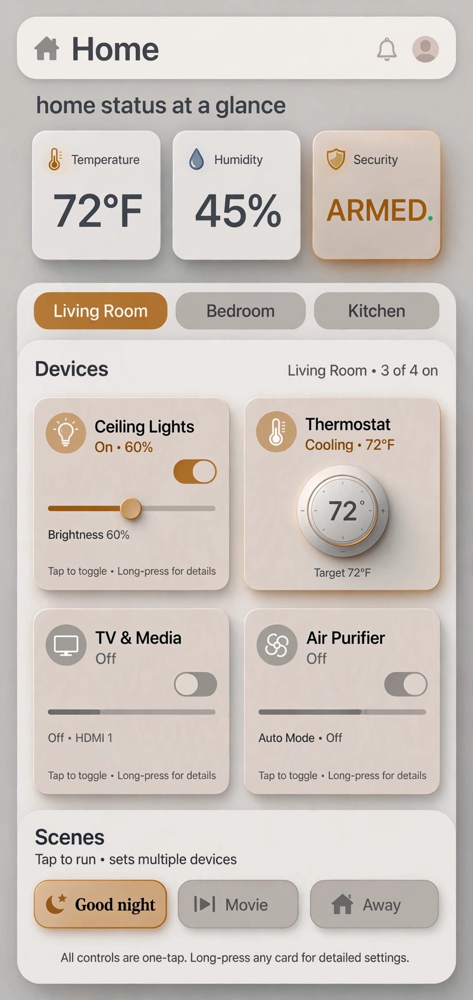

# 智能家居

## 智能家居控制面板：房间+设备总控 (`smart-home-dashboard`)



生成验证：✅ 2026-11-18 通过 — 生成图为智能家居面板：顶部温湿度/安防ARMED大数字一行、房间tabs、设备卡片网格（开关+长按提示）、圆形温控旋钮、调光滑杆、Good night/Movie/Away场景行，暖灰底琥珀开启态、关闭态弱化，通过

- 风格：智能家居 / 设备控制 / 仪表盘
- 场景：做智能家居/物联网 App，要一眼看清全屋设备状态并快速控制时
- 适用工具：v0、Lovable、Cursor

**EN prompt（复制用）**

```
Design a smart home control dashboard: top shows home status at a glance (temperature, humidity, security armed/disarmed) in one row of large readable numbers; below, room tabs (Living Room, Bedroom, Kitchen) switch the device grid; each device is a card with an icon, name, current state and a large touch target — tap toggles on/off, long-press opens detailed controls. Include a round thermostat dial with a soft extruded ring, light dimmer sliders, and a scenes row ('Good night', 'Movie', 'Away') that sets multiple devices at once. Light warm-gray background with soft tactile shadows, one amber accent for 'on' states, off devices visibly muted. All controls reachable with one thumb, no nested menus for common actions.
```

**中文说明**：智能家居总控：顶部一眼看全屋状态（温湿度/安防）、房间切换+设备卡片网格（点按开关、长按细调）、圆形温控旋钮+场景一键切换，开启态用琥珀色、关闭态弱化。
