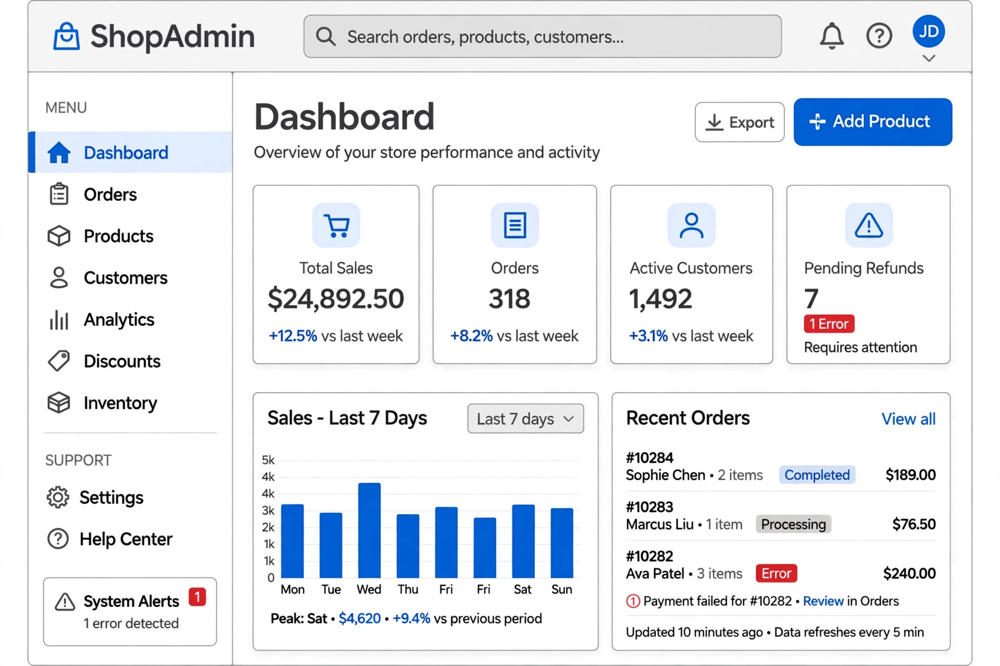
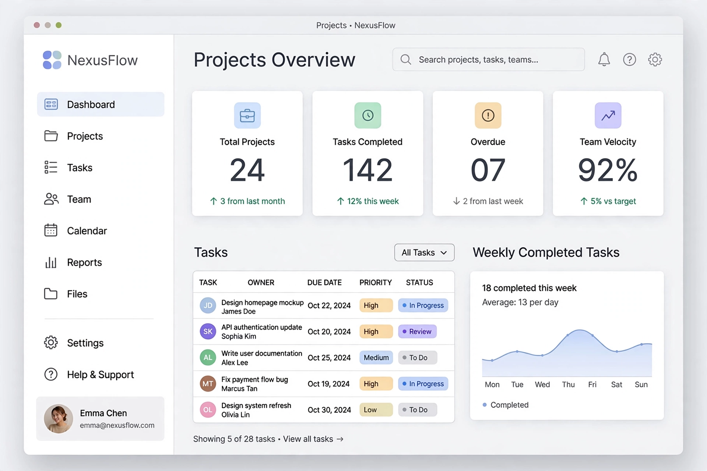
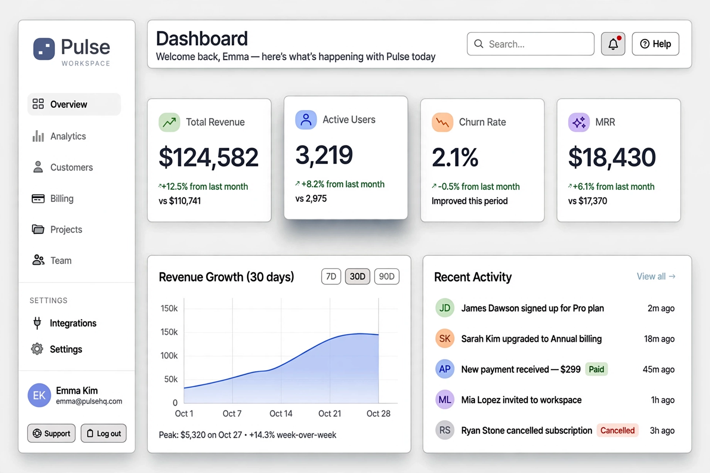
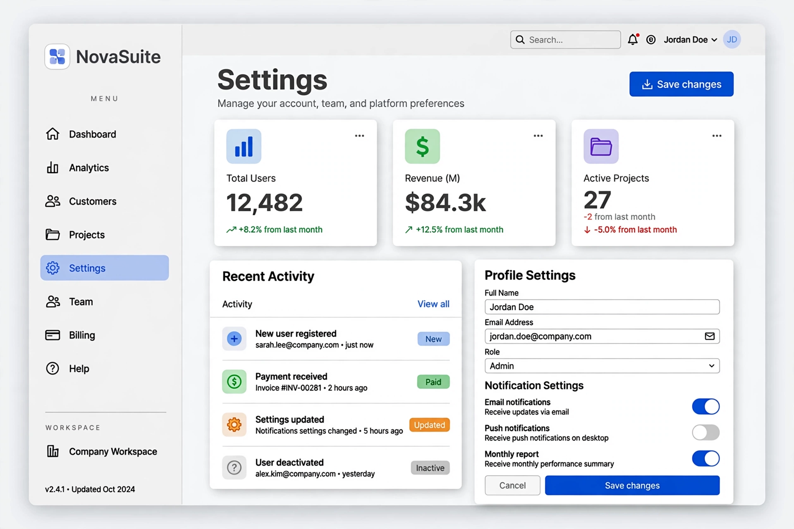
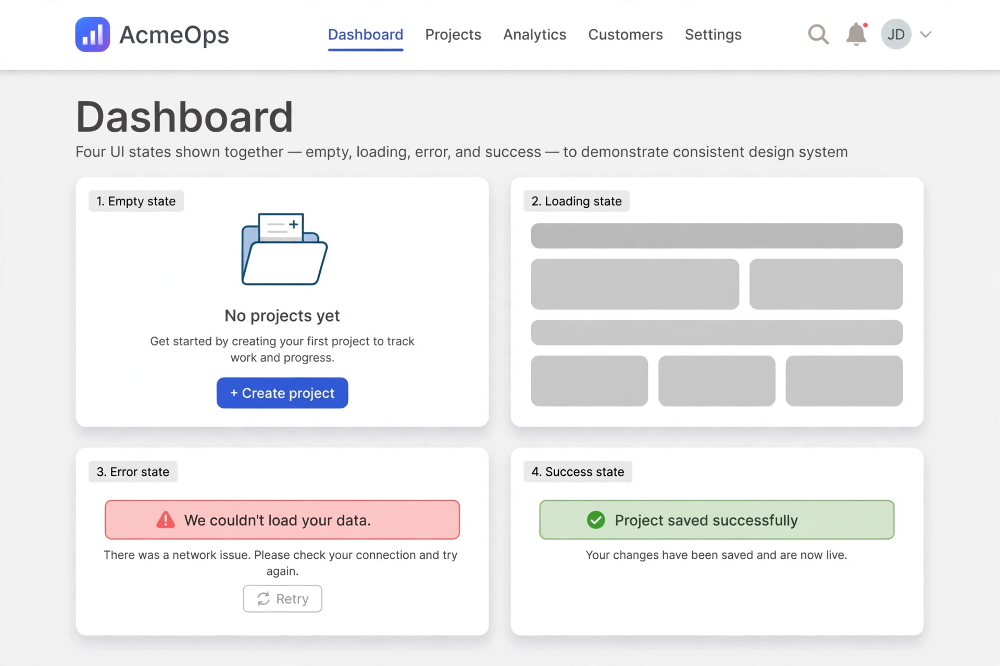

# 细节优化

## 间距节奏：8pt 网格呼吸感 (`detail-spacing-rhythm`)


生成验证：✅ 2026-11-17 通过 — 生成图为项目管理后台：分组间距分明、卡片内边距一致、标题与主按钮周围留白充足，通过

- 风格：间距 / 极简 / 秩序感
- 场景：任何界面显乱/挤时的间距优化改版
- 适用工具：v0、Lovable、Cursor

**EN prompt（复制用）**

```
Refine this UI's spacing to feel calm and premium: use a strict 8pt spacing system (8/16/24/32/48), group related elements tightly and separate groups generously, align everything to a clear grid, increase whitespace around headings and primary actions, keep card padding consistent at 24px, and remove any random one-off margins. Same content and colors, only spacing and alignment change.
```

**中文说明**：只改间距：严格 8pt 系统、组内紧组间松、卡片内边距统一 24px、标题和主按钮周围留白加大，内容配色不动，界面立刻显贵。

## 配色克制：一主色 + 中性灰 (`detail-color-restraint`)



生成验证：✅ 2026-11-17 通过 — 生成图为电商后台 ShopAdmin：仅蓝色主色+中性灰，红色只出现在错误徽章，通过

- 风格：配色 / 克制 / 高级感
- 场景：界面花花绿绿/像模板时的配色收敛
- 适用工具：v0、Lovable、Cursor

**EN prompt（复制用）**

```
Recolor this UI to look more designed: keep exactly one primary brand color, one accent for warnings/errors only, and build everything else from a neutral gray scale (text #1A1A1A, secondary #666, borders #E5E5E5, background #FAFAFA); remove all decorative gradients and rainbow icon colors; colored elements must mean something (status, action, selection), never decoration.
```

**中文说明**：配色收敛到一个主色+一个警示色，其余全用中性灰阶；删掉装饰性渐变和彩虹图标，颜色只表达状态/操作/选中。

## 费纸张5细节合集（原作版） (`detail-feizhang-five`)


生成验证：✅ 2026-11-17 通过 — 生成图为带侧边栏的分析后台：KPI 大数字、折线图、表格、嵌套卡片柔和阴影，五件套特征可见，通过

- 风格：细节 / 原作摘录 / 合集
- 场景：生成任何界面时一次性交代5个易忽视细节
- 适用工具：v0、Lovable、Cursor

**EN prompt（复制用）**

```
Pay attention to these 5 small details that make AI-generated UI feel comfortable: (1) tabular numbers — use font-variant-numeric: tabular-nums so digits never jitter; (2) concentric corner radius — outer radius = inner radius + padding (e.g. border-radius: calc(20px + 16px)), never the same radius inside and out; (3) staggered entrance — split the entrance into icon, title, body and button, appearing one after another with ~100ms stagger; (4) balanced headline wrapping — text-wrap: balance on headings so no orphan word sits alone on the last line; (5) shadows instead of borders — replace 1px solid borders with soft multi-layer box-shadows for natural edges.
```

**中文说明**：源自抖音 @费纸张《5个小细节让AI设计的界面看着更舒服》（AI设计技巧分享第3集，2026-10-21，作品 7699104647889423667，2026-11-17 已核对画面/字幕/文案）。五件套一次交代：等宽数字、同心圆角、错开入场、标题平衡换行、阴影代替边框。

## 同心圆角：外层=内层+内边距 (`detail-concentric-radius`)


生成验证：✅ 2026-11-17 通过 — 生成图为嵌套卡片示意图：外层 24px / 内层 8px 并标注公式，外内圆角平行顺滑，通过

- 风格：圆角 / 细节 / 卡片
- 场景：卡片套图片/按钮套容器等嵌套圆角场景
- 适用工具：v0、Cursor

**EN prompt（复制用）**

```
Use concentric corner radii for nested elements: the outer container's border-radius must equal the inner element's radius plus the padding between them (e.g. inner 20px radius with 16px padding → outer radius 36px, border-radius: calc(20px + 16px)). Never give inner and outer elements the same radius — that makes corners look pinched and wrong.
```

**中文说明**：嵌套圆角要同心：外层半径 = 内层半径 + 内边距（如 20+16=36），内外一样大是错误做法，角会显挤。源自费纸张视频细节2。

## 错开入场：元素依次登场 (`detail-staggered-entrance`)


生成验证：✅ 2026-11-17 通过 — 生成图为协作功能卡片：图标、标题、正文、按钮四元素依次排列并标注 0/100/200/300ms 错开与 200-300ms ease-out，GIF 真实呈现依次入场，通过

- 风格：动效 / 入场 / 细节
- 场景：页面/卡片首次出现的入场动画
- 适用工具：v0、Lovable

**EN prompt（复制用）**

```
Stagger the entrance animation: split the block into icon, title, body text and button, and let them fade/slide in one after another with about 100ms stagger between elements instead of everything appearing at once. Keep each animation short (200-300ms, ease-out) so it feels ordered and calm, never bouncy.
```

**中文说明**：入场要错开：图标、标题、正文、按钮拆开依次入场，间隔约 100ms，不要整块一起蹦出来。源自费纸张视频细节3（片尾汇总为100ms间隔）。

## 等宽数字：数字不跳动 (`detail-tabular-nums`)


生成验证：✅ 2026-11-17 通过 — 生成图为分析后台：KPI 数字、价格表数字列对齐整齐，倒计时 00:12:34:56 以等宽数字呈现，通过

- 风格：数字 / 字体 / 细节
- 场景：价格/计时器/数据表格等数字会变化的界面
- 适用工具：v0、Cursor、Qoder

**EN prompt（复制用）**

```
Use tabular numbers everywhere numbers can change (prices, timers, counters, tables): font-variant-numeric: tabular-nums; so every digit has the same width and values never shift or jitter when they update. Apply it to KPI figures, prices, countdowns and any numeric column by default.
```

**中文说明**：会变的数字一律等宽：font-variant-numeric: tabular-nums，每个数字一样宽，更新时不左右跳。源自费纸张视频细节1。

## 字体层级：三级标题拉开层次 (`detail-type-hierarchy`)



生成验证：✅ 2026-11-18 通过 — 生成图为项目管理后台：28px 大标题、18px 分区标题、14px 正文、12px 说明，层级全靠字重字号，数据数字等宽放大，通过

- 风格：字体 / 层级 / 可读性
- 场景：界面看着平/没重点时的字体优化
- 适用工具：v0、Cursor、Qoder

**EN prompt（复制用）**

```
Improve this UI's typography hierarchy: only three heading levels plus body and caption text; page title 28px semibold, section title 18px medium, body 14px regular with 1.6 line height, captions 12px in gray; use weight and size — not color — to create hierarchy; limit the design to one font family and at most 4 font sizes per screen; make numbers in data areas tabular and slightly larger.
```

**中文说明**：字体只留三级标题+正文+小字：靠字重和大小分层不用颜色，一屏最多 4 种字号，正文行高 1.6，数据数字放大用等宽数字。

## 阴影与边框：细边框代替重阴影 (`detail-shadow-border`)



生成验证：✅ 2026-11-18 通过 — 生成图为数据后台（重验后）：四张 KPI 卡单行排列无重叠，1px 细边框+一层极淡阴影、圆角统一 12px，其中一张轻微抬起为悬停态，通过；首版生成有两张卡片重叠，已重生成

- 风格：阴影 / 边框 / 轻量
- 场景：卡片显脏/显廉价时的质感优化
- 适用工具：v0、Cursor

**EN prompt（复制用）**

```
Fix the cheap look of these cards: replace heavy drop shadows with a 1px border (#0000000F) plus one very soft shadow (0 1px 2px rgba(0,0,0,0.04)); unify corner radius to 12px everywhere; remove inner shadows and glow effects; interactive cards may lift slightly on hover with a deeper shadow, static cards stay flat. The result should feel like Linear/Notion — quiet and precise.
```

**中文说明**：卡片去廉价感：重阴影换成 1px 细边框+一层极淡阴影，圆角统一 12px，删内阴影和发光，Linear/Notion 式安静精准。

## 对齐强迫症：左边缘一条线 (`detail-alignment-grid`)



生成验证：✅ 2026-11-18 通过 — 生成图为设置页：同列元素共用左边缘、图标统一尺寸、列表行高内边距一致、表单标签与输入框基线对齐，通过

- 风格：对齐 / 网格 / 秩序感
- 场景：元素参差不齐/看着歪时的对齐修正
- 适用工具：v0、Cursor、Qoder

**EN prompt（复制用）**

```
Audit and fix alignment in this UI: every text block, icon and button in a column must share the same left edge; icon sizes unified to 20px inside 40px touch targets; list rows share identical height and padding; form labels and inputs align to one baseline grid; no element may sit at a unique random offset — if it cannot align, remove it. Pixel-perfect order is the goal.
```

**中文说明**：对齐修正：同列元素共用左边缘、图标统一 20px/点击区 40px、列表行高内边距一致、表单基线对齐，对不齐的元素宁可删掉。

## 状态补全：空/加载/错误态 (`detail-states-complete`)



生成验证：✅ 2026-11-18 通过 — 生成图为四态同屏：空状态（小插图+一句话+主按钮）、骨架屏加载、行内错误+重试、安静成功提示，同一视觉语言，通过

- 风格：状态 / 完整度 / 产品感
- 场景：界面像半成品时的状态补全设计
- 适用工具：v0、Lovable、Cursor

**EN prompt（复制用）**

```
Design the missing states for this product UI so it feels finished: (1) empty state with a small illustration, one-line explanation and a primary action button; (2) skeleton loading screens matching the real layout, no spinners on white; (3) inline error states with what happened + how to retry, in plain language; (4) success confirmation that is quiet, not a confetti modal. Keep all states in the same visual language as the main UI.
```

**中文说明**：补齐四种状态：空状态（小插图+一句话+主按钮）、骨架屏加载、说人话的行内错误+重试、安静的成功反馈，风格与主界面一致。
