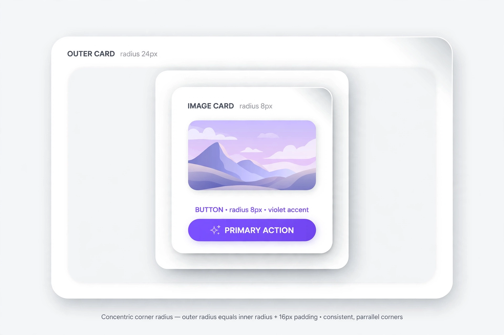

# 细节优化

## 间距节奏：8pt 网格呼吸感 (`detail-spacing-rhythm`)


生成验证：✅ 2026-11-17 通过 — 生成图为项目管理后台：分组间距分明、卡片内边距一致、标题与主按钮周围留白充足，通过

- 风格：间距 / 极简 / 秩序感
- 场景：任何界面显乱/挤时的间距优化改版
- 适用工具：v0、Lovable、Cursor

**EN prompt（复制用）**

```
Refine this UI's spacing to feel calm and premium: use a strict 8pt spacing system (8/16/24/32/48), group related elements tightly and separate groups generously, align everything to a clear grid, increase whitespace around headings and primary actions, keep card padding consistent at 24px, and remove any random one-off margins. Same content and colors, only spacing and alignment change.
```

**中文说明**：只改间距：严格 8pt 系统、组内紧组间松、卡片内边距统一 24px、标题和主按钮周围留白加大，内容配色不动，界面立刻显贵。

## 配色克制：一主色 + 中性灰 (`detail-color-restraint`)


生成验证：✅ 2026-11-17 通过 — 生成图为电商后台 ShopAdmin：仅蓝色主色+中性灰，红色只出现在错误徽章，通过

- 风格：配色 / 克制 / 高级感
- 场景：界面花花绿绿/像模板时的配色收敛
- 适用工具：v0、Lovable、Cursor

**EN prompt（复制用）**

```
Recolor this UI to look more designed: keep exactly one primary brand color, one accent for warnings/errors only, and build everything else from a neutral gray scale (text #1A1A1A, secondary #666, borders #E5E5E5, background #FAFAFA); remove all decorative gradients and rainbow icon colors; colored elements must mean something (status, action, selection), never decoration.
```

**中文说明**：配色收敛到一个主色+一个警示色，其余全用中性灰阶；删掉装饰性渐变和彩虹图标，颜色只表达状态/操作/选中。

## 费纸张5细节合集（原作版） (`detail-feizhang-five`)


生成验证：✅ 2026-11-17 通过 — 生成图为带侧边栏的分析后台：KPI 大数字、折线图、表格、嵌套卡片柔和阴影，五件套特征可见，通过

- 风格：细节 / 原作摘录 / 合集
- 场景：生成任何界面时一次性交代5个易忽视细节
- 适用工具：v0、Lovable、Cursor

**EN prompt（复制用）**

```
Pay attention to these 5 small details that make AI-generated UI feel comfortable: (1) tabular numbers — use font-variant-numeric: tabular-nums so digits never jitter; (2) concentric corner radius — outer radius = inner radius + padding (e.g. border-radius: calc(20px + 16px)), never the same radius inside and out; (3) staggered entrance — split the entrance into icon, title, body and button, appearing one after another with ~100ms stagger; (4) balanced headline wrapping — text-wrap: balance on headings so no orphan word sits alone on the last line; (5) shadows instead of borders — replace 1px solid borders with soft multi-layer box-shadows for natural edges.
```

**中文说明**：源自抖音 @费纸张《5个小细节让AI设计的界面看着更舒服》（AI设计技巧分享第3集，2026-10-21，作品 7699104647889423667，2026-11-17 已核对画面/字幕/文案）。五件套一次交代：等宽数字、同心圆角、错开入场、标题平衡换行、阴影代替边框。

## 同心圆角：外层=内层+内边距 (`detail-concentric-radius`)



生成验证：✅ 2026-11-17 通过 — 生成图为嵌套卡片示意图：外层 24px / 内层 8px 并标注公式，外内圆角平行顺滑，通过

- 风格：圆角 / 细节 / 卡片
- 场景：卡片套图片/按钮套容器等嵌套圆角场景
- 适用工具：v0、Cursor

**EN prompt（复制用）**

```
Use concentric corner radii for nested elements: the outer container's border-radius must equal the inner element's radius plus the padding between them (e.g. inner 20px radius with 16px padding → outer radius 36px, border-radius: calc(20px + 16px)). Never give inner and outer elements the same radius — that makes corners look pinched and wrong.
```

**中文说明**：嵌套圆角要同心：外层半径 = 内层半径 + 内边距（如 20+16=36），内外一样大是错误做法，角会显挤。源自费纸张视频细节2。
