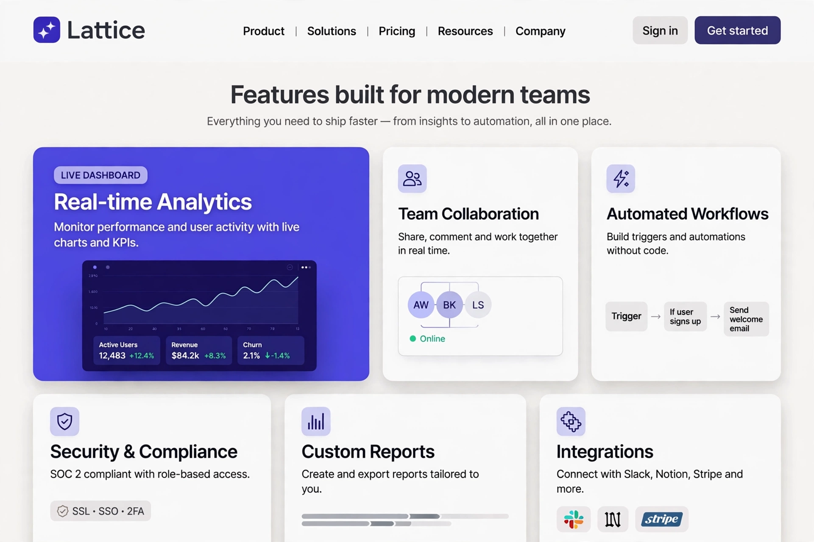

# 落地页官网

## AI 产品落地页 (`landing-ai-product`)

- 风格：深色 / 渐变光效 / 科技感
- 场景：AI 工具/SaaS 产品官网首屏
- 适用工具：v0、Lovable、Framer

**EN prompt（复制用）**

```
Design a high-converting landing page hero for an AI product: dark background with subtle aurora gradient glow, huge bold headline, one-line subheadline, email input + CTA button, product screenshot in a browser mockup with soft shadow and glow, logo wall of trusted companies below, then a 3-column feature section with icons. Modern tech aesthetic like Linear/Vercel, lots of whitespace, one accent color.
```

**中文说明**：AI 产品落地页：深色+极光渐变光效、大标题、邮箱输入+CTA、带光晕的产品截图、客户 logo 墙、三栏功能区，Vercel/Linear 感。

## 编辑杂志风品牌官网 (`landing-editorial`)

- 风格：大字体 / 留白 / 黑白
- 场景：设计工作室/独立品牌官网
- 适用工具：v0、Framer、Cursor

**EN prompt（复制用）**

```
Create an editorial, magazine-style brand website: off-white paper background, oversized serif headline typography, black and white palette with one red accent, asymmetric grid layout, large photography, numbered sections, fine hairline rules, generous whitespace, refined and confident like a print magazine brought to the web. No gradients, no rounded cards.
```

**中文说明**：杂志编辑风官网：米白纸感底、超大衬线标题、黑白+一点红、不对称网格、细线分割、大量留白，拒绝渐变和圆角卡片。

## 新丑风/粗野主义落地页 (`landing-brutalist`)

- 风格：新丑风 / 粗野主义 / 高对比
- 场景：潮流品牌/独立产品/活动页
- 适用工具：v0、Lovable

**EN prompt（复制用）**

```
Design a neo-brutalist landing page: raw white background, thick black borders (3px) on every element, hard offset shadows with no blur, bright clashing accent colors (yellow, hot pink, cyan), huge grotesque sans-serif headlines, marquee ticker strip, sticker-like badges rotated slightly, monospace details. Loud, playful, anti-corporate, but keep the grid aligned and readable.
```

**中文说明**：新丑风落地页：粗黑边框、无模糊硬阴影、黄/粉/青撞色、超大标题、跑马灯条、贴纸徽章，闹但网格要齐。

## Bento 便当网格功能区 (`landing-bento-grid`)



生成验证：✅ 2026-11-19 通过 — 生成图为 Lattice 功能区：6 格 Bento（1 大格仪表盘视觉+2 中格+3 小格）、16px 等距、20px 统一圆角、每格一标题一行文案一视觉、米白底白卡、靛蓝只在主格，通过

- 风格：Bento网格、卡片、极简
- 场景：SaaS/AI 产品功能展示区
- 适用工具：v0、Lovable、Framer

**EN prompt（复制用）**

```
Lay out the features section as a bento grid: 6 tiles of mixed sizes on a 12-column grid, one large 2x2 tile for the hero feature with a product visual, two medium tiles and three small tiles for supporting features, equal 16px gaps and unified 20px corner radius, each tile holds exactly one heading, one line of copy and one visual — no text walls. Light neutral background #F7F7F5, white tiles with 1px border #E7E5E4, one indigo accent only on the hero tile. Stack to a single column on mobile, keep tile order by importance.
```

**中文说明**：Bento 功能区：6 块大小不一的瓷砖、主功能占大格、统一 16px 间距和 20px 圆角、每格一标题一行文案一视觉，移动端单列堆叠。
